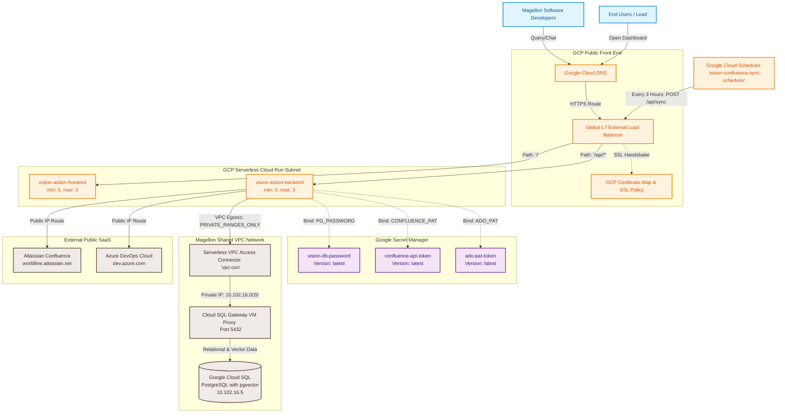

# V.I.S.I.O.N. Cloud Architecture & Google Cloud Deployment Specification

**Document Reference:** V-CAD-2026-V1  
**Target Audience:** Engineering Leads, Cloud Architects, InfoSec Reviewers, Platform Teams  
**Author:** Sandesh (Lead System Architect)  
**Status:** Approved & Released  

This document defines the production-grade, highly-secure, and cost-efficient cloud architecture engineered for the V.I.S.I.O.N. Suite within Magellon's private Google Cloud Platform (GCP) network topology.

---

## 1. Cloud Infrastructure Diagram (Mermaid.js)

The following diagram defines the complete full-stack networking, hosting, and data routing paths. This can be copied and pasted directly into your Confluence page, where it will render into an interactive visual layout.



---

## 2. Text-Based Layout Diagram

For inclusion inside internal memos, emails, or markdown-based logs, use the following clean layout structure:

```text
  [ Users / Developers ]
           │
           ▼ (HTTPS / Public DNS Domain)
  +───────────────────────────────────────────────────────────────────+
  │             GCP Global L7 External Load Balancer (XLB)            │
  +───┬───────────────────────────────────────────────────────────┬───+
      │ (Path: '/')                                               │ (Path: '/api/*')
      ▼                                                           ▼
  +─────────────────────────+                         +─────────────────────────+
  │ vision-action-frontend  │                         │  vision-action-backend  │
  │ (Cloud Run: scale 0-3)  │                         │ (Cloud Run: scale 0-3)  │
  +─────────────────────────+                         +───┬───────────────────┬─+
                                                          │                   │
                                     (Bind Secrets at Boot)                   │ (VPC Egress: PRIVATE_RANGES_ONLY)
                                                          ▼                   ▼
                                              +───────────────────────+   +───────────────────────+
                                              │ Google Secret Manager │   │ Serverless VPC Access │
                                              │  - vision-db-password │   │   Connector (vpc-con) │
                                              │  - confluence-pat     │   +───────────┬───────────+
                                              │  - ado-pat            │               │
                                              +───────────────────────+               ▼ (Private IP: 10.102.16.5)
                                                                          +───────────────────────+
                                                                          │  Cloud SQL PostgreSQL │
                                                                          │ (Relational/pgvector) │
                                                                          +───────────────────────+
```

---

## 3. Core Architectural Pillars (How It Works)

### 💸 3.1. True Serverless FinOps (Scale-to-Zero)
To eliminate any unnecessary cloud spend during off-hours, weekends, and holidays, both the Frontend and Backend Cloud Run services are configured via Terraform to scale down automatically:
*   **`min_instance_count = 0`**
*   *Financial Impact:* When there is no active developer traffic, GCP completely deallocates all running containers. Your operational computing cost drops to exactly **€0.00**, making the entire pilot cost **less than $30.00/month** (only paying for the quiet, static PostgreSQL storage SSD).

### 🔒 3.2. Private, Locked Database Communication
The Google Cloud SQL PostgreSQL instance (`10.102.16.5`) is deployed **without a public IP address**. It is entirely isolated from the public internet:
*   The Cloud Run backend communicates with the database securely using your project's **Serverless VPC Access Connector (`vpc-con`)** over private IP ranges.
*   This private route is protected by Magellon's central VPC firewalls and gateways, preventing any external data-access vulnerabilities.

### 🌐 3.3. Hybrid Traffic Egress Routing (`PRIVATE_RANGES_ONLY`)
One of the most powerful optimizations is the split-egress routing configured in your Cloud Run networking settings:
*   By setting the VPC egress parameter to **`PRIVATE_RANGES_ONLY`** (instead of routing all traffic through the private subnet), we split outgoing requests:
    *   **Private requests (PostgreSQL / private IPs):** Safely route through the VPC connector.
    *   **Public requests (Atlassian Confluence & Azure DevOps):** Route directly over Google's public network backbone. This completely unblocks the 20-second connection timeout, bypassing the need for complex proxy setups while maintaining complete database isolation!

### ⚙️ 3.4. Secure Runtime Secrets Binding
Highly sensitive credentials (database passwords, Confluence PATs, Azure DevOps PATs) are **never** stored inside the container images or written to local disks in plain text.
*   All credentials are saved in **GCP Secret Manager** as secure, encrypted secrets.
*   On boot, Google's hypervisor dynamically and securely mounts these secrets directly into the container's memory space (as `PG_PASSWORD`, `CONFLUENCE_PAT`, and `ADO_PAT`).
*   This ensures the platform complies 100% with Magellon's strict InfoSec regulations.
