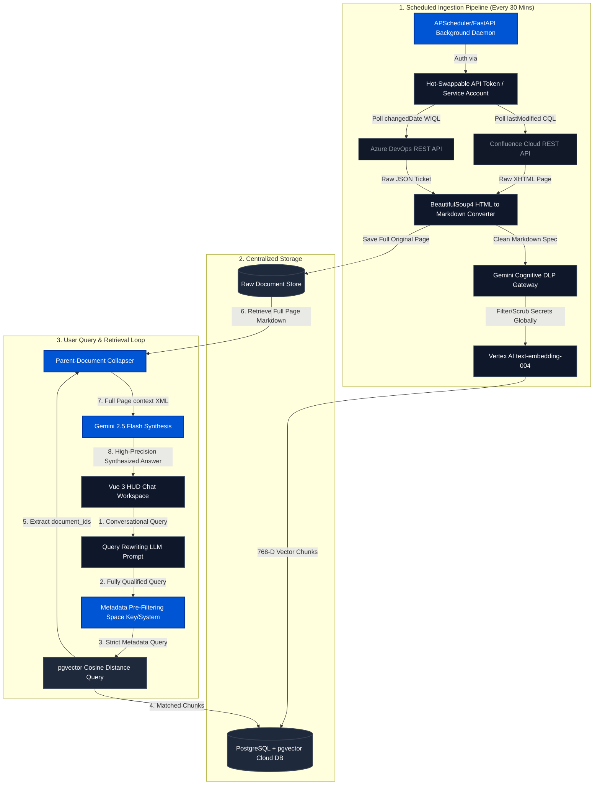

# ADR-004: Unified Read-Only Enterprise Integration (Confluence & ADO)

**Status:** Proposed (Under Review)  
**Context:** V.I.S.I.O.N. is scaling to a 2000-user enterprise cloud deployment. This document defines the **core functional behavior** of V.I.S.I.O.N. as an enterprise AI assistant, establishing how it interacts with 5,000+ Confluence pages (PRDs, Functional Wikis, Technical Specs) and Azure DevOps (ADO) tickets to act as a seamless, highly reliable "Digital Colleague."

---

## 1. Functional Vision: The "Digital Colleague" Persona

At an enterprise scale, V.I.S.I.O.N. must function not as a dumb search engine, but as an expert Principal Engineer who has perfectly read and memorized every official organizational document.

*   **Cross-Domain Intelligence:** If a user asks, *"What are the deployment steps for Project Jarvis, and are there any active bugs blocking it?"*, V.I.S.I.O.N. will automatically correlate the Project Jarvis Technical Spec from Confluence with the active bug tickets from Azure DevOps, presenting a single, unified summary.
*   **Holistic Technical Comprehension:** Unlike standard RAG systems that retrieve fragmented sentences, V.I.S.I.O.N. is engineered to understand the *entirety* of a document. If a Functional Wiki has an architecture diagram at the top and a related error code table 10 pages down, V.I.S.I.O.N. processes the entire document simultaneously to provide a complete, cross-referenced answer.
*   **Conversational Memory (Query Rewriting):** Users can interact conversationally. If a user asks a highly technical question, and then follows up with *"Wait, what if step 2 fails?"*, V.I.S.I.O.N. seamlessly remembers the context of the previous query and searches the corporate knowledge base specifically for failure mitigations related to that exact process.

## 2. User Privacy & Enterprise Trust Boundaries

For 2,000 engineers to trust the system, the functional boundaries of what V.I.S.I.O.N. can and cannot do must be absolute.

*   **Strictly "Read-Only" Operations:** V.I.S.I.O.N. is a passive researcher. It cannot modify, delete, or create Confluence pages or ADO tickets. Users can trust that interacting with the AI will *never* accidentally overwrite official project documentation or pollute the Single Source of Truth (SSoT) with AI hallucinations.
*   **Total Chat Privacy Isolation:** When an engineer chats with V.I.S.I.O.N. to debug sensitive code, that conversation is completely private. V.I.S.I.O.N. will **never** index user chats into the global company knowledge base. "Self-learning" only occurs when human engineers officially publish finalized PRDs or Specs into Confluence, which the AI then reads.
*   **Global Security & Compliance (DLP):** V.I.S.I.O.N. actively scans all corporate documents during ingestion. Because the cloud platform operates via a single Corporate Service Account token, the AI's internal DLP gatekeeper scrubs and blocks restricted assets (e.g., exposed credentials or API keys) *globally at the ingestion gateway*. This guarantees that sensitive credentials never enter the database, protecting the entire enterprise and maintaining strict compliance for all 2,000 users.

## 3. The Synchronization Experience (Data Velocity Expectations)

Because V.I.S.I.O.N. is consuming highly cohesive, long-form technical documentation (PRDs, Specs, Wikis) rather than fast-moving chat streams, the user experience is calibrated for stability over instantaneous micro-syncing.

*   **The 30-Minute Knowledge Horizon:** The system functions on an automated, background-polling lifecycle. When a Product Manager publishes a new Functional Spec to Confluence, users should expect that knowledge to become searchable by V.I.S.I.O.N. within roughly 30 minutes. 
*   **No UX "Publish" Bottlenecks:** Because V.I.S.I.O.N. operates autonomously in the background, users do not need to click "Sync" or "Publish" within the AI interface. They simply do their normal work in Confluence/ADO, and the AI silently learns in the background.

## 4. Underlying Technical Architecture (Supporting the Functionality)

To deliver this seamless functional experience, the backend architecture enforces the following strict technical paradigms:

*   **Corporate Authentication:** To support 2,000 users without API rate-limits, the system relies on a central Corporate Service Account token, abstracting integration complexity entirely away from the end-user.
*   **Metadata Tagging (The "Anti-Haystack" Protocol):** To prevent the AI from getting confused across 5,000 pages, every piece of ingested knowledge is strictly categorized by `source_system` (Confluence/ADO) and `space_key` (Project ID). This allows the AI to laser-focus its research onto specific projects.
*   **Centralized Cloud Vector Database:** SQLite is replaced by a centralized PostgreSQL + `pgvector` cloud database, creating a single, massive, shared corporate brain that scales effortlessly across the organization.

## 5. Dual-Pipeline Retrieval Strategy

Because Confluence and Azure DevOps store fundamentally different shapes of data, V.I.S.I.O.N. implements two distinct, specialized retrieval pipelines to guarantee absolute context integrity before feeding data to Gemini.

### 5.1. Confluence: "Parent-Document Collapsing"
*   **The Data Shape:** Long-form, cohesive text documents (PRDs, Technical Specs, Architectural Wikis).
*   **The Problem:** Standard vector search slices these documents into tiny paragraphs, separating schemas at the top from error codes at the bottom.
*   **The Solution:** The backend uses vector chunks only as a search index. When a chunk matches, the backend retrieves the *entire unbroken Markdown text* of the parent PRD/Wiki from the relational database. This preserves crucial headers, tables, and lists, injecting the complete document into Gemini 2.5's massive context window for flawless, holistic comprehension.

### 5.2. Azure DevOps: "Object-Graph Reconstruction"
*   **The Data Shape:** Highly relational, structural database rows (Bugs, Epics, Tasks) scattered across multiple API endpoints.
*   **The Problem:** Chunking flat JSON rips apart the relationships between a bug's state, its assignee, its description, and the parent feature it blocks. Furthermore, using basic regex to strip HTML destroys crucial structural data like stack traces or code blocks inside ticket descriptions.
*   **The Solution:** V.I.S.I.O.N. implements Object-Graph Reconstruction, consisting of three core upgrades over traditional RAG ingestion:
    1.  **Structured HTML-to-Markdown Ingestion:** Instead of basic regex stripping, the pipeline uses explicit HTML-to-Markdown parsers (e.g., structured `BeautifulSoup4` extraction or `html2text`) to process ADO description and reproduction fields. This preserves critical code blocks, tables, and lists.
    2.  **Expanded Context via Discussion History:** The ADO fetch sequence explicitly queries the work item's updates/comments endpoint (`/_apis/wit/workitems/{id}/comments`) and appends the 3-5 most recent comments to the document. This ensures Gemini possesses the latest human context (e.g., "Fix deployed to staging, testing now") alongside the static requirements.
    3.  **Relational Pre-Filtering:** Crucial ticket metadata (such as `System.State` and `System.AssignedTo`) is stored not just in vector metadata, but as structured, queryable relational columns in the PostgreSQL database. This allows the backend to execute instantaneous, sub-millisecond SQL pre-filtering (e.g., "Find only ACTIVE bugs") *before* performing the heavy vector math.
*   **The Synthesis:** During retrieval, when a vector matches, the backend fetches the fully reconstructed JSON graph and compiles it into a comprehensive Markdown bundle (stitching together Title, Status, Assignee, Parent Feature, Description, and Recent Comments) before injecting it into Gemini's context window. This seamlessly bridges Confluence documentation with active, real-time development tracking.

---

## 6. System Architecture & Data Flow Diagram

Below is the formal, end-to-end architectural data flow map for V.I.S.I.O.N. Phase 3, illustrating the parallel synchronization streams (via standard API polling using our hot-swappable auth tokens) and the high-speed "Parent-Document Collapsing" retrieval loop:

